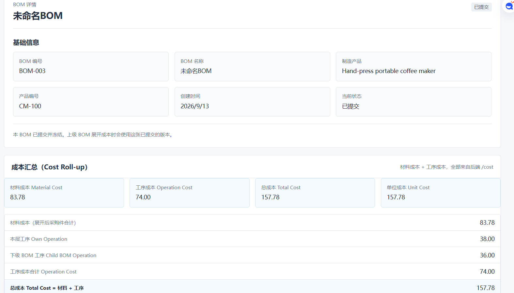
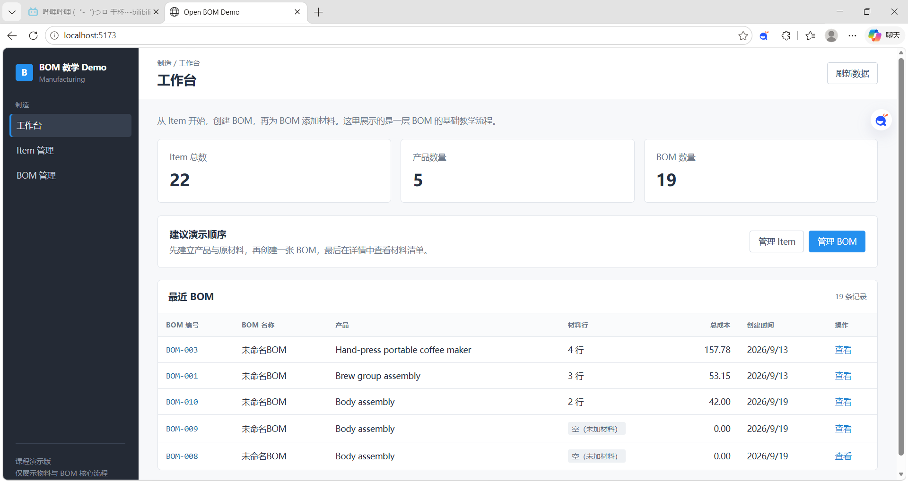

# BOM Demo

一个轻量级 ERPNext-inspired BOM 管理与成本卷积演示系统，展示多级 BOM Explosion、Material Roll-up 和 Operation Cost Roll-up。它用于学习制造业 ERP 中 BOM（Bill of Materials）、物料展开（Explosion）以及成本卷积（Cost Roll-up）的基本概念。

```text
Item（产品 / 原材料）
        ↓
       BOM
        ↓
   BOM Item（材料清单行）
```

## 成本计算流程

> 以下示例基于全新种子数据库，BOM-003 对应 ID 3。已有数据库中的 ID 可能不同。

```text
BOM-003 CM-100

        CM-100
          |
    +-----+-----+
    |           |
GROUP-ASM    BODY-ASM
    |           |
材料展开       材料展开
    |           |
Leaf Material Cost
          |
    +-----+
          |
 Operation Cost Roll-up
          |
      Total Cost
```

```text
Leaf Material Cost
= BOM Explosion 后所有最低层采购件的材料成本

Child BOM Operation Cost
= 子 BOM 工序成本

Current BOM Operation Cost
= 当前 BOM 的工序成本

Operation Cost
= Child BOM Operation Cost + Current BOM Operation Cost

Total Cost
= Leaf Material Cost + Operation Cost
```

## Features

- ✅ Item 主数据管理
- ✅ BOM 创建与维护
- ✅ 多级 BOM Explosion
- ✅ BOM 版本管理


## 项目结构

```text
frontend/              React + Vite 前端
  src/main.jsx         React 挂载入口
  src/App.jsx          页面结构、表单和数据展示
  src/api.js           对 FastAPI 接口的请求封装
  src/styles.css       Desk 风格的原生 CSS

backend/app/           FastAPI 后端
  main.py              程序入口、路由注册
  database.py          SQLite 连接和数据库会话
  models.py            SQLAlchemy 数据表模型
  schemas.py           API 的请求和响应数据格式
  routers_items.py     Item 接口
  routers_boms.py      BOM 接口
  services.py          BOM 校验、序列化和兼容性业务逻辑
  seed.py              首次启动时的示例数据

start_demo.bat         一键启动（后端 + 前端 + 打开浏览器）

data/
  bom_demo.db 运行时生成的 SQLite 数据库
```

## 数据如何流动

1. 用户在 React 页面输入 Item 或 BOM 数据。
2. `src/api.js` 用 `fetch` 请求 `/api/items` 或 `/api/boms`。
3. Vite 将 `/api` 代理到 FastAPI（默认 `http://127.0.0.1:8000`）。
4. FastAPI 路由用 Pydantic 校验 JSON 数据。
5. SQLAlchemy 将 `Item`、`BOM`、`BOMLine`、`BOMOperation` 对象保存到 SQLite。
6. 后端再把查询结果以 JSON 返回给 React 表格和详情页。

## 当前界面功能

- 工作台：显示 Item 总数、产品数量和 BOM 数量。
- Item 管理：查看并创建产品、原材料和半成品物料。
- BOM 管理：查看列表、新建草稿（材料清单在新建页录入）、查看详情。
- BOM 详情：清晰显示产品和材料行（材料、数量、单位）。
- 系统支持多级 BOM、版本管理、工序以及成本接口。
- 当前界面重点展示 BOM 管理和成本卷积流程，保持教学演示的简洁性。

## Demo Preview

### Dashboard




### BOM Cost Roll-up




## API Example

获取 BOM 成本：

```text
GET /api/boms/3/cost
```

> 以下示例基于全新种子数据库，BOM-003 对应 ID 3。已有数据库中的 ID 可能不同。

示例响应（CM-100）：

```text
material_cost (Leaf Material Cost): 83.782
operation_cost (Operation Cost): 74.0
total_cost (Total Cost): 157.782
```

## Requirements

- Python >= 3.11
- Node.js >= 20.19
- npm >= 9

## 快速开始

### 安装依赖

第一次使用时，先创建后端虚拟环境并安装依赖，再安装前端依赖。

**后端：**

```powershell
cd backend
python -m venv .venv
.venv\Scripts\pip install -r requirements.txt
```

**前端：**

```powershell
cd frontend
npm install
```

> 一键启动脚本假定 `backend\.venv` 已经创建并安装好依赖。

### 一键启动 Demo

首次完成依赖安装后，可以直接双击根目录中的 `start_demo.bat`。

脚本会自动完成：

1. 启动 FastAPI 后端。
2. 启动 React 前端。
3. 打开 Demo 页面。

需要 Python 3.11+、Node.js 20.19+，并已完成上面的依赖安装。

### 手动启动

仍可使用以下手动启动方式。

**后端：**

```powershell
cd backend
.venv\Scripts\python.exe -m uvicorn app.main:app --reload --port 8000
```

**前端：**

```powershell
cd frontend
npm run dev
```

前端：<http://localhost:5173>

后端：<http://127.0.0.1:8000>

API 文档：<http://127.0.0.1:8000/docs>


## 系统架构

```text
React Frontend
       |
       |
 FastAPI REST API
       |
       |
 SQLAlchemy ORM
       |
       |
 SQLite Database
```


## SQLite 数据库

数据库位于 `data/bom_demo.db`。程序首次启动时，若 `items` 表为空，会写入示例数据；已有数据不会被覆盖。

若希望回到初始示例，请先手动备份或删除该数据库文件，再重新启动后端。SQLite 文件不会提交到 Git。


## 许可证

MIT License

Copyright (c) 2026 Mountain3311

This project is an educational implementation inspired by ERP manufacturing concepts.
It is not affiliated with ERPNext or Frappe.